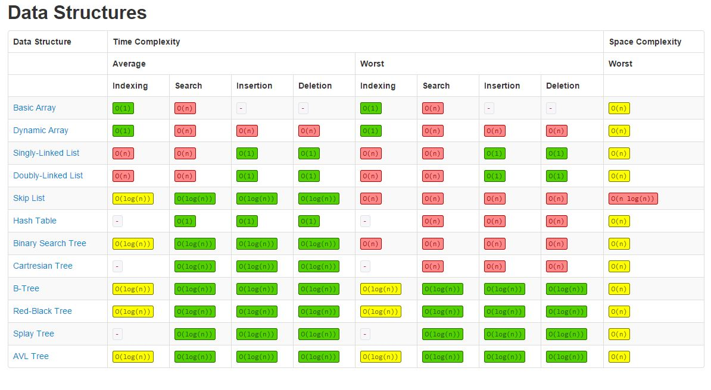

<div align="center">

# Java: Data Structures, Algorithms and OOP

Notes and from-scratch Java implementations of core data structures, algorithms and object-oriented programming concepts.

 

</div>

## About

A study repository I built while learning data structures and algorithms in Java. Every data structure here is implemented from scratch rather than taken from the Java Collections Framework, and most folders include notes, diagrams and handwritten exercise sheets.

## Contents

### Data structures

| Topic | Implementations |
| --- | --- |
| [Arrays](Data_Structures/Arrays) | Array rotation with the juggling algorithm |
| [Linked List](Data_Structures/LinkedList) | Singly linked list with reverse and k-th node from the end |
| [Stack](Data_Structures/Stack) | Fixed-size array-based stack |
| [Queue](Data_Structures/Queue) | Array-based circular queue, queue built from two stacks |
| [Hash Map](Data_Structures/HashMap) | Hash table with chaining, custom hash map |
| [Heap](Data_Structures/Heap) | Max heap, heapify |
| [Tree](Data_Structures/Tree) | Binary search tree, AVL tree |
| [Graphs](Data_Structures/Graphs) | Graph with DFS, BFS, topological sort and cycle detection; [weighted graph](Data_Structures/Graphs/WeightedGraph) with Dijkstra, Prim, Kruskal and Bellman-Ford |

### Algorithms

| Topic | Implementations |
| --- | --- |
| [Searching](Algorithms/Searching) | Binary search |
| [Sorting](Algorithms/Sorting) | Bubble, selection, insertion, merge and quick sort |

### Object-oriented programming

| Topic | Contents |
| --- | --- |
| [Classes](OOPs/1_Classes) | Notes and quiz |
| [Inheritance](OOPs/2_Inheritance) | Notes on inheritance and polymorphism, quiz |
| [Interfaces](OOPs/3_Interfaces) | Notes |

[`FINAL450.xlsx`](FINAL450.xlsx) is my progress tracker for the [450 DSA questions](https://github.com/neelbavarva/450) sheet.

## Complexity cheat sheet

<table>
  <tr><td></td></tr>
</table>

## Running the code

Most of the sorting and searching algorithms include a `main` method. The data structures are plain classes you can use from your own driver class.

Source files use packages that start with `Java.`, so clone the repository into a folder named `Java` and compile from its parent folder:

```bash
git clone https://github.com/neelbavarva/java.git Java
javac Java/Algorithms/Sorting/MergeSort.java
java Java.Algorithms.Sorting.MergeSort
```

You can also open the `Java` folder in IntelliJ IDEA.

## Project Structure

```
.
├── Algorithms/         # searching and sorting
├── Data_Structures/    # implementations with notes
├── OOPs/               # object-oriented programming notes and quizzes
└── Z_Images/           # diagrams used in the notes
```
